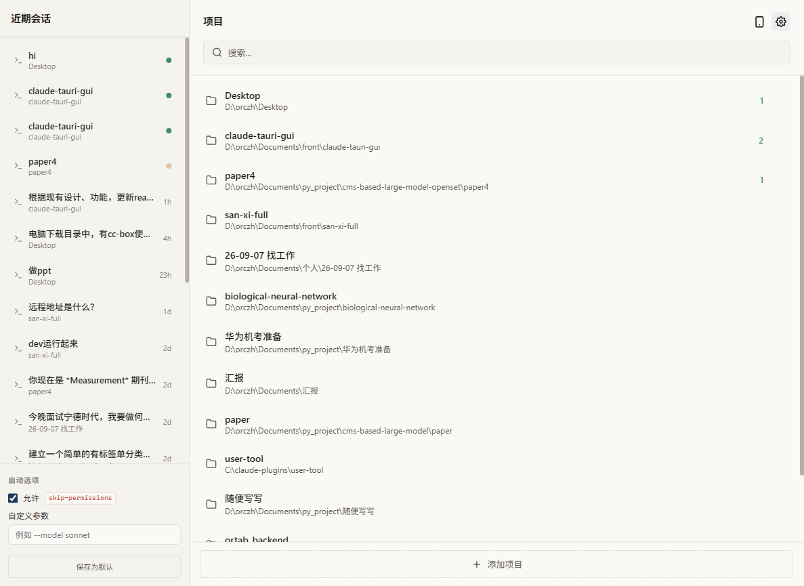
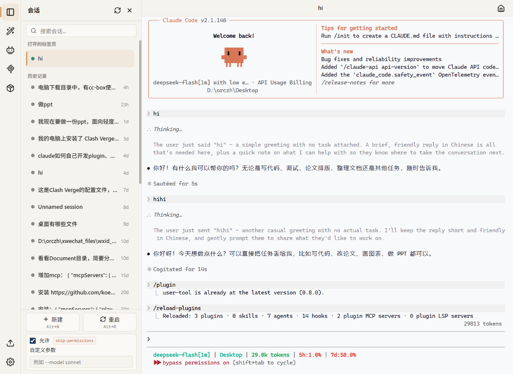

<p align="center">
  
</p>

<h1 align="center">CC-Box</h1>

<p align="center">
  <strong>A desktop app for <a href="https://docs.anthropic.com/en/docs/claude-code">Claude Code</a> — multi-project, multi-session management & remote access from your phone</strong><br>
  One window. Multiple projects. Instant session switching. Even from your phone.
</p>

<p align="center">
  
  
  
  
</p>

---

English | [简体中文](README_CN.md)

---

## Why CC-Box?

Claude Code's CLI is excellent for single-session work. But when you're managing **multiple projects** and need to **view, enter, and switch between sessions quickly** — the terminal alone becomes cumbersome.

CC-Box is essentially a **desktop application for Claude Code**. It wraps the CLI with a native terminal experience and adds the things the CLI can't do well: multi-project management, session overview, quick switching — and full remote control from your phone, so your desktop sessions travel with you.

**Think of it as a desktop app purpose-built for Claude Code power users.**

---

## Screenshots

<p align="center">
  
  
</p>

---

## Highlights

### Multi-Project Management

Browse all your projects in one place. See which projects have active sessions, launch a new session with one click, and switch between projects instantly. No more `cd` between directories or managing multiple terminal windows.

### Multi-Session in One Window

Open as many Claude Code sessions as you need — each runs independently in its own terminal tab. View all sessions in the sidebar, switch between them instantly, output is preserved when you switch back.

### Quick Launch with Presets

Set per-project startup options like `--resume`, `--model`, or custom flags. Launch sessions with your preferred configuration without typing the same arguments every time.

### Provider Management

Switch between API providers with one click. 50+ built-in presets for popular vendors, import existing configs from [cc-switch](https://github.com/farion1231/cc-switch), and keep shared settings in a common config applied to every provider. Activation merges safely into Claude Code's `settings.json` — unrelated fields are never touched.

### Sidebar Panels

A side drawer with contextual panels — no overlay, no focus stealing:

- **Sessions** — Browse, search, and switch between all sessions. Status indicators show running/thinking/waiting states.
- **MCP Servers** — Inspect connected MCP servers, browse available tools and their input schemas, toggle servers on/off
- **Skills & Agents** — Browse and toggle your Claude Code skills and agent configurations
- **Plugins** — View installed plugins and their components, toggle them on/off

### Remote Control from Your Phone

Pair once with a QR code, then open your desktop sessions from any phone browser — over LAN at home, or from anywhere via a self-hosted relay (public-network access with zero inbound ports on your desktop).

- **Full session control** — view terminals, type, approve prompts, create/close/rename sessions, exactly like sitting at the desk
- **Per-session control** — multiple devices can work different sessions at the same time; takeovers are announced, never silent
- **Two-way file transfer** — upload photos/logs straight into the project (path inserted into the terminal for you), download project files via one-time ticket links that work in WeChat and system browsers
- **Device list with connectivity probe** — see online/offline/token-invalid before you tap; unreachable devices explain why
- **Secure by default** — remote access is off by default; pairing is per-device and revocable in one click ("Rotate Secret" unpairs everything instantly)

### Tray, Multi-Window & Auto-Update

CC-Box keeps a background broker with a tray icon. Every window is one click away in the tray menu; the phone sees sessions grouped by window and can spawn a new window when none is open. Optional start-on-boot, and in-app auto-updates with a tray badge when a new version is ready.

### Live Session Status, Synced Everywhere

CLI hook events stream into a status machine — running / thinking / waiting for input — shown on tabs and the sidebar, and mirrored to your phone in real time. Sessions with unread activity are marked, and opening one clears the mark on every device. Hide projects you don't want in the home list (re-adding restores their recent sessions).

### Native Terminal, Zero Compromise

The app runs the real Claude CLI binary through a pseudo-terminal. Everything works exactly as in your terminal — slash commands, keyboard shortcuts, streaming output, colors, and interactive prompts.

---

## Prerequisites

- **[Claude Code CLI](https://docs.anthropic.com/en/docs/claude-code)** installed and authenticated
- **Windows only**: [Git for Windows](https://git-scm.com/download/win) (provides Git Bash)

---

## Quick Start

### 1. Download & Install

Head to the [**Releases**](https://github.com/orczh-hj/cc-box/releases) page and grab the installer for your platform:

| Platform | File |
|----------|------|
| **Windows** | `.exe` (NSIS installer) or `.msi` |
| **macOS** | `.dmg` (universal binary) |
| **Linux** | `.deb` or `.AppImage` |

Users in China can download from [Gitee Releases](https://gitee.com/orczh/cc-box/releases).

### 2. Launch & Go

1. Open the app
2. Select or add a project directory
3. A Claude Code session starts — just type as you would in the terminal
4. Open more sessions from the sidebar, each runs independently

---

## Building from Source

<details>
<summary>Click to expand</summary>

### Prerequisites

- [Node.js](https://nodejs.org/) 18+
- [Rust](https://www.rust-lang.org/tools/install) stable toolchain
- [Claude Code CLI](https://docs.anthropic.com/en/docs/claude-code) installed and authenticated
- **Windows only**: [Git for Windows](https://git-scm.com/download/win)

### Setup

```bash
git clone https://github.com/orczh-hj/cc-box.git
cd cc-box
npm install
```

### Development

```bash
npm run tauri:dev     # Start dev mode with hot reload
```

### Build

```bash
npm run tauri:build   # Build for current platform

# Or platform-specific:
npm run build:win     # Windows (x86_64-pc-windows-gnu)
npm run build:mac     # macOS (native arch; updater publishes Apple Silicon/arm64)
npm run build:linux   # Linux (x86_64)
```

Output goes to `src-tauri/target/release/bundle/`.

</details>

---

## FAQ

<details>
<summary><strong>Does this modify my Claude Code config?</strong></summary>

The app only **reads** native Claude Code files, with one exception: activating a provider merges its environment config into `settings.json` (unrelated fields are never touched, and GUI state fields are stripped). All GUI-specific settings are stored separately in `~/.cc-box/`. You can go back to the CLI at any time.
</details>

<details>
<summary><strong>Can I use all CLI features?</strong></summary>

Yes. Slash commands, keyboard shortcuts, model switching, permission prompts — everything passes through to the real CLI transparently.
</details>

<details>
<summary><strong>What's the performance like?</strong></summary>

Built with Tauri 2 (Rust backend), the app is ~10 MB installed and uses minimal RAM. The terminal renders via xterm.js, matching native terminal performance.
</details>

<details>
<summary><strong>Will it break when Claude Code updates?</strong></summary>

The app runs the CLI binary directly — it doesn't depend on any internal API. As long as the CLI is on your PATH, it works with any version.
</details>

<details>
<summary><strong>Is the remote access secure?</strong></summary>

Remote access is **off by default**. Each device pairs via a one-time QR code and holds its own token; "Rotate Secret" revokes every paired device instantly. LAN mode never leaves your network; relay mode goes through a relay you deploy yourself, which only routes TLS traffic and never parses application payloads. File downloads use one-time tickets that expire in 10 minutes. All remote traffic is audited in `~/.cc-box/logs`.
</details>

---

## Tech Stack

Tauri 2 (Rust) + Vue 3 + TypeScript + xterm.js + portable-pty

---

## License

[MIT](LICENSE)